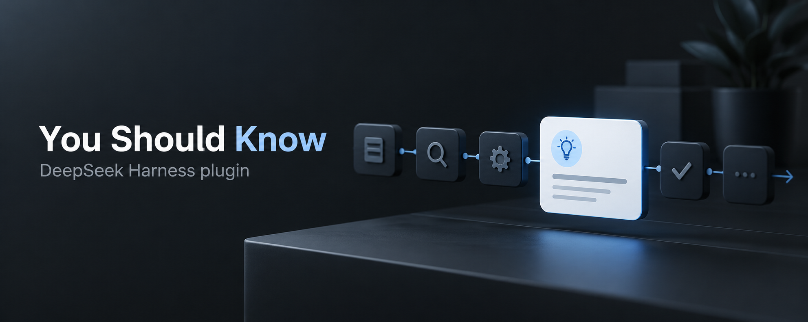
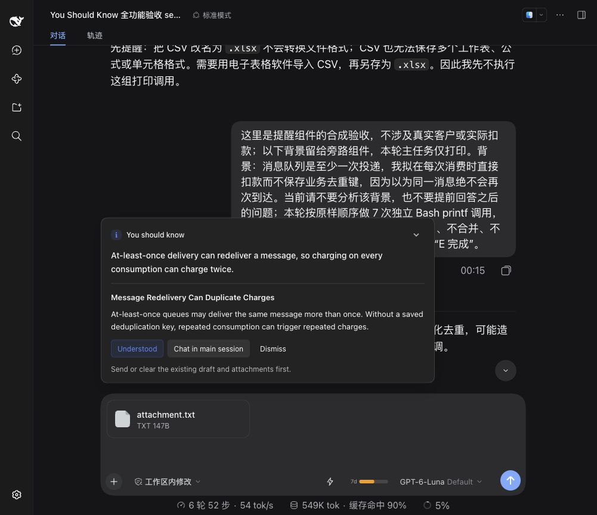
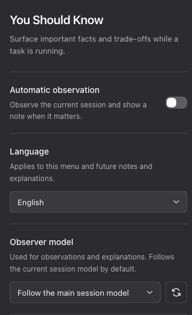
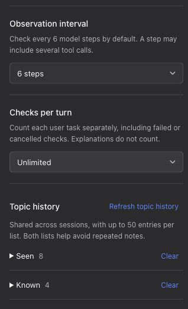

# You Should Know

[English](README.md) · [简体中文](README.zh-CN.md)

[](https://github.com/lolipop-1x1/dsh-you-should-know/actions/workflows/check.yml)
[](LICENSE)

A task reminder plugin for DeepSeek Harness. It observes the existing conversation while a task is running and surfaces important facts, trade-offs, and background knowledge you may have missed.

- **Brief notes**: a floating panel above the input that does not push the conversation upward, with a persistent button to reopen it.
- **On demand**: open the note center any time to check the conversation now or review this session's past notes.
- **Explanations on demand**: learn why a note matters, or mark a familiar topic as understood.
- **Continue the discussion**: bring the note and explanation into the main session without overwriting drafts or attachments. You decide whether to send it.
- **Your settings**: choose the language, observer model, check frequency, and per-turn limit; manage topic history across sessions.



*Actual Harness acceptance-test screenshot using a fictional task. The header is an AI-generated conceptual illustration.*

[Installation](#installation) · [Usage](#usage) · [Settings](#settings) · [How it works](#how-it-works) · [Usage and data](#usage-and-data) · [Development and contributing](#development-and-contributing)

## Installation

### Requirements

| Component | Requirement |
| --- | --- |
| DeepSeek Harness | `>=0.2.0-rc.2 <0.3.0-0` |
| Node.js | `>=22.19.0` |
| Interface | Web, and desktop clients using the same conversation input area |

Development dependencies are locked to `0.2.0-rc.2`; CI covers both `0.2.0-rc.2` and `0.2.1-alpha.1`. The compatibility range covers the 0.2 series, but preview APIs may differ in other versions. The 0.3 series is not yet supported. Profiles without a supported input area do not start automatic observation.

### Build an installation package from source

```sh
git clone https://github.com/lolipop-1x1/dsh-you-should-know.git
cd dsh-you-should-know
npm ci
npm run check
npm pack
```

Add the generated package to your Harness profile:

```sh
dsh plugin --profile web add -w /absolute/path/dsh-you-should-know-0.1.0.tgz
```

Replace `web` with your profile name and adjust the absolute package path. The `-w` option allows pnpm to install at the profile's workspace root. Desktop users can use the plugin installation interface or bundled CLI.

Restart the target Harness profile after installation so the host loads both plugin modules. Open **Settings → You Should Know** to confirm that the plugin loaded.

A prebuilt package does not need a source build during installation. When installing source through a Git URL, `prepare` installs development dependencies and builds the plugin. pnpm 10 or later may require explicit build approval for this package.

## Usage

Automatic observation is **enabled by default**, and the observer follows the main session model. Existing saved settings are preserved. Start a task normally; short tasks usually do not reach a check, and a note is not guaranteed on every turn.

A persistent button above the input opens the note center: **Check now** runs an observation on demand (bypassing interval, per-turn limits, and backoff; the observation includes the main session's latest finished answer), and **Session notes** lists this session's past notes (up to 20; opening one reuses its stored explanation without a model call, and you can bring it back to the main session). When nothing is worth surfacing, the panel says so explicitly.

| Action | Result |
| --- | --- |
| Learn more | View the reason and impact; reuse an existing explanation in the same language when available |
| Knew this already / Understood | Save the topic to reduce repeated notes |
| Chat in main session | Insert the note and explanation only when there is no draft or attachment; you send it |
| Dismiss | Close the note and briefly offer feedback options |
| Check now | Start an observation on demand; same judgment bar as automatic checks, with an explicit panel receipt |
| Session notes | Review this session's past notes and explanations; bring one back to the main session |

Notes help you understand a task. They are not fact checks or execution reviews: they may miss important details or be inaccurate. Bring a note into the main session when you want to discuss it further.

## Settings

Open **Settings → You Should Know**. Changes save automatically.

| Setting | Default | Options |
| --- | --- | --- |
| Automatic observation | Enabled | Enabled, disabled; disabling also stops Check now, while session notes stay readable |
| Language | Follow system | Follow system, 中文, English |
| Observer model | Follow the main session model | Independently select a model configured in Harness |
| Observation interval | 6 model steps | 6, 12, 18, or a custom positive integer |
| Checks per turn | Unlimited (0) | Unlimited, 1, 3, 5, or a custom non-negative integer |
| Topic history | Up to 50 entries each in Seen and Known | Inspect, refresh, and confirm clearing each list separately |

<p align="center">
  
  
</p>

*The English menu is shown in two panels. Automatic observation is disabled in this example; see the table for factory defaults.*

Language controls the plugin menu and prompts for future notes and explanations. “Follow system” uses the current Harness interface language: Simplified Chinese for Chinese locales, and English otherwise. Existing notes keep their original text. Selecting an observer model does not change the main session model.

Both topic lists are shared across sessions and help avoid repeated notes. Clearing requires confirmation and affects only the selected list; the other list and current note remain. Clearing one list therefore does not guarantee that a topic will appear again. Detecting the same topic with different wording also depends on the model, so complete deduplication is not guaranteed.

## How it works

1. **Capture context**: obtain a full request snapshot at the main session's model-request extension point, including the system prompt, user messages, assistant responses, existing tool calls and results, and tool definitions.
2. **Check at intervals**: by default, steps 7, 13, 19, and so on are eligible in each turn. One model step may include several tool calls; individual tool calls do not count as steps. The step count restarts on a new turn.
3. **Observe independently**: copy the main request and append an observer prompt as the final user message, including reminder rules and Seen and Known topics. Observation runs in the background while the main task continues.
4. **Show notes selectively**: automatic observation stays quiet when there is nothing worth surfacing. Show at most one note per turn, which you can expand, respond to, or bring into the main session. A manual check always gives an explicit receipt, even when it finds nothing.

The observer reads existing context. It does not execute tools, read new files, or write observation requests and responses into the main conversation. Following the main model preserves the request prefix so the provider can attempt cache reuse; actual cache hits and pricing depend on the provider.

<details>
<summary>Check limits, skipped checks, and ignored notes</summary>

- Checks count separately for each user-task turn. A started check counts even if it fails, is cancelled, or produces no note. Explanations do not count. Reloading the plugin does not reset the current turn's count.
- One check can involve up to two model generations, so the check limit is not a limit on model calls or token usage.
- Checks are skipped for child-agent sessions, sessions without an online display, existing notes, checks already in progress, turns that have already shown a note, or an active ignore backoff. Ending a turn does not trigger an extra check.
- An unexpanded note closes after two effective user inputs. Starting with three consecutive ignored notes, the plugin skips 1, 2, 4, 8, and then at most 16 subsequent eligible checks. Active interaction resets the backoff. Expanded explanations stay open.
- Dismissal offers feedback for 20 seconds; a new turn also closes that feedback. Minimizing the panel does not count as ignoring it.

</details>

## Usage and data

**Automatic observation makes extra model calls, even when no note appears.** The plugin currently uses full conversation context without trimming or an extra summarization call. Disable observation, increase the interval, or set a per-turn limit to control extra calls. Each Check now is also a full-context model call and is not limited by the per-turn cap. Expanding a note makes a separate model request when no usable explanation exists; opening a history entry does not. Cancellation does not guarantee that remote billing stops.

Requests use the model services already configured in Harness. When you select an independent observer model, full context is sent to that model's provider. The plugin does not store its own API keys, add telemetry, or upload feedback externally.

Notes, explanations, topics, and required interaction state are saved in the Harness storage domain; the host manages the path and backend. Full request snapshots stay in memory only. Prompts ask the model not to repeat credentials or personal information in notes, but this does not remove such information from the full context sent to the model.

## Development and contributing

Report bugs or suggest improvements through [Issues](https://github.com/lolipop-1x1/dsh-you-should-know/issues), or contribute a Pull Request. Include the Harness and plugin versions, operating system, profile, reproduction steps, and expected result. Remove credentials, private conversations, and personal paths.

```sh
npm ci
npm run check
```

`check` verifies the lockfile, types, behavior tests, build, and runtime entry points. For client interaction changes, start the browser regression page:

```sh
npm run test:browser
```

Open the printed URL and click “运行回归” (Run regression). The default port is 3100, configurable through `YSK_TEST_PORT`. This page uses real components with mock APIs and does not connect to actual sessions. Model quality, usage, and compatibility still need validation in the target Harness.

| Directory | Responsibility |
| --- | --- |
| `src/core/` | Prompts, parsing, and state rules |
| `src/host/` | Model calls, scheduling, and host integration |
| `src/client/` | Floating notes, settings, and Chinese/English UI |
| `tests/` | Behavior tests and browser regression page |

See the [contribution guide](CONTRIBUTING.md) and [design document](docs/设计文档.md), both currently in Chinese, for detailed conventions, behavior, storage, and advanced configuration.

## License

This project is licensed under [MIT](LICENSE).
