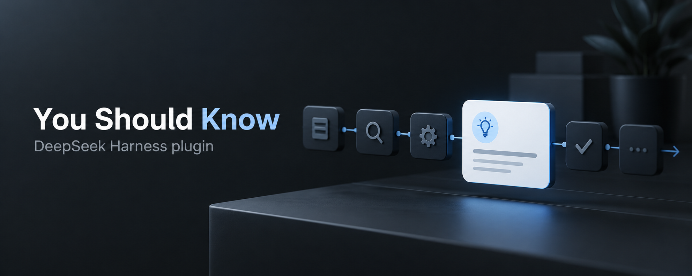
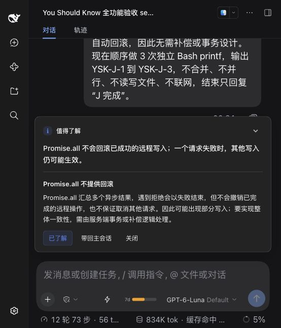
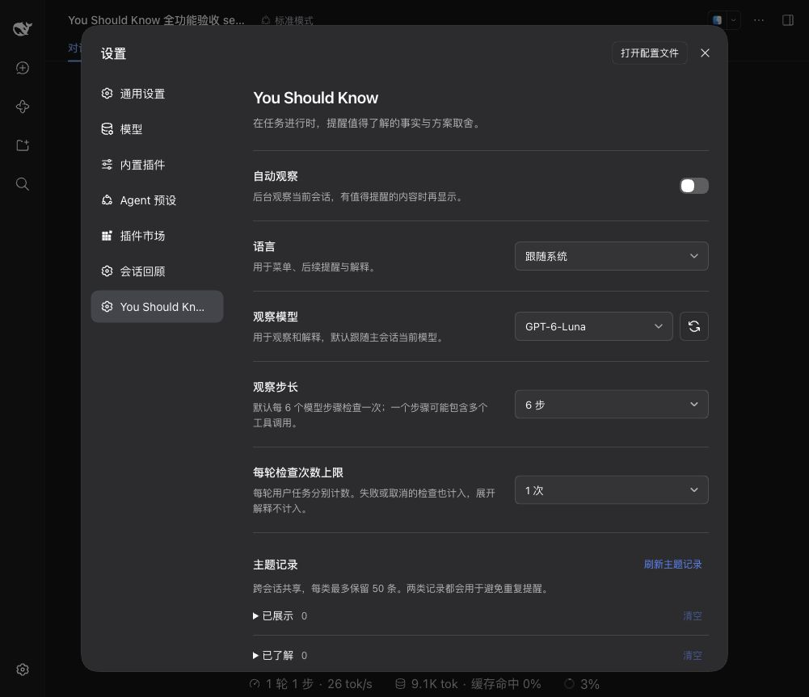

# You Should Know

[English](README.md) · [简体中文](README.zh-CN.md)

[](https://github.com/lolipop-1x1/dsh-you-should-know/actions/workflows/check.yml)
[](LICENSE)

DeepSeek Harness 的任务提醒插件。在任务进行时，观察已有会话中的重要事实、方案取舍和必要知识，帮助你理解可能遗漏的事项。

- **简短提醒**：在输入框上方悬浮展示，不挤占聊天内容；常驻按钮可随时重新打开。
- **按需查看**：随时打开提醒中心，立即观察当前对话，或回看本会话的提醒历史。
- **按需解释**：展开了解原因和影响；已经知道的主题可以标记为已了解。
- **继续讨论**：把提醒和解释带回主会话，保留已有草稿和附件，由你决定是否发送。
- **自主设置**：选择语言、观察模型、检查频率和每轮上限，管理跨会话主题记录。



*实际 Harness 验收截图，使用虚构任务。头图为 AI 生成的概念插画。*

[安装](#安装) · [使用](#使用) · [设置](#设置) · [工作方式](#工作方式) · [用量与数据](#用量与数据) · [开发与贡献](#开发与贡献)

## 安装

### 环境要求

| 项目 | 要求 |
| --- | --- |
| DeepSeek Harness | `>=0.2.0-rc.2 <0.3.0-0` |
| Node.js | `>=22.19.0` |
| 界面 | Web，以及使用相同会话输入区的桌面端 |

开发依赖锁定在 `0.2.0-rc.2`，CI 同时覆盖 `0.2.0-rc.2` 与 `0.2.1-alpha.1`。兼容声明覆盖 0.2 系列；其他版本仍可能存在预览 API 差异，0.3 系列尚不支持。没有可展示输入区的 profile 不自动观察。

### 从源码构建安装包

```sh
git clone https://github.com/lolipop-1x1/dsh-you-should-know.git
cd dsh-you-should-know
npm ci
npm run check
npm pack
```

将生成的安装包添加到你的 Harness profile：

```sh
dsh plugin --profile web add -w /absolute/path/dsh-you-should-know-0.1.0.tgz
```

将 `web` 替换为实际 profile 名称，并修改安装包的绝对路径。`-w` 允许 pnpm 在 profile 的 workspace 根安装。桌面端可使用其插件安装入口或随附 CLI。

安装后重启目标 Harness profile，让宿主加载插件的服务端与客户端模块。打开 **设置 → You Should Know** 确认插件已加载。

已构建的安装包无需在安装时编译源码。通过 Git 地址安装源码时，`prepare` 会安装开发依赖并构建；pnpm 10 及以上可能需要为本包单独授权构建。

## 使用

自动观察**默认开启**，观察模型默认跟随主会话。已保存的设置会继续保留。正常发起任务即可；短任务通常不会触发检查，也不会保证每轮都有提醒。

输入框上方右侧有插件的常驻按钮，点击展开提醒中心：可以**立即观察**当前对话（不受步长、每轮上限和退避限制；观察包含主会话刚完成的回答），也可以回看**本会话提醒历史**（最多 20 条，展开已有解释不再调用模型，可带回主会话）。没有发现值得提醒的事项时，面板会明确回执。

| 操作 | 结果 |
| --- | --- |
| 展开解释 | 查看事项的原因与实际影响；优先复用已生成的同语言解释 |
| 已经知道 / 已了解 | 保存主题，减少后续重复提醒 |
| 带回主会话 | 输入框没有草稿或附件时，填入提醒和解释；由你发送 |
| 关闭 | 关闭提醒，并短暂提供反馈选项 |
| 立即观察 | 主动发起一次观察；判断标准与自动一致，结果在面板回执 |
| 本会话提醒 | 回看本会话出现过的提醒及解释，可带回主会话 |

提醒用于帮助理解任务，并非事实核验或执行审查。它可能遗漏重要事项，也可能判断不准确；需要时可带回主会话进一步讨论。

## 设置

在 **设置 → You Should Know** 中调整，下列设置会自动保存。

| 设置 | 默认值 | 可选项 |
| --- | --- | --- |
| 自动观察 | 开启 | 开启、关闭；关闭后立即观察一并停用，历史仍可回看 |
| 语言 | 跟随系统 | 跟随系统、中文、English |
| 观察模型 | 跟随主会话模型 | 独立选择 Harness 已配置的模型 |
| 观察步长 | 6 个模型步骤 | 6、12、18 或自定义正整数 |
| 每轮检查次数上限 | 不限（0） | 不限、1、3、5 或自定义非负整数 |
| 主题记录 | 已展示、已了解各最多 50 条 | 分别查看、刷新和确认清空 |



*菜单示例选用了 GPT-6-Luna、每轮最多检查 1 次，并关闭了自动观察；出厂默认值见上表。*

语言控制插件菜单及后续提醒、解释的提示词。“跟随系统”使用 Harness 当前界面语言，中文界面使用简体中文，其余语言使用英文。已有提醒保留原文。单独选择观察模型不会改变主会话模型。

两类主题记录跨会话共享，都会参与去重。清空需要确认，只处理所选列表，保留另一类记录和当前提醒。因此清空一类记录不保证相同主题再次出现；不同措辞的主题还需要模型判断，不能保证完全去重。

## 工作方式

1. **取得上下文**：在主会话的模型请求扩展点获取完整请求快照，包含系统提示、用户消息、助手回答、已有工具调用与结果，以及工具声明。
2. **按步长检查**：默认在每轮第 7、13、19 等模型步骤获得检查机会。一个模型步骤可能包含多个工具调用，工具调用本身不单独计步；开始新轮后重新计步。
3. **独立判断**：复制主请求，再追加观察提示词作为最后一条用户消息，包含提醒规则、已展示和已了解的主题。观察在后台执行，主任务继续运行。
4. **选择性展示**：自动观察没有值得提醒的事项时保持安静。同一轮最多展示一条提醒；用户可以展开、反馈或带回主会话。手动观察必须给出回执，即使没有发现。

观察者只读取已有上下文，不运行工具、不读取新文件，也不把观察请求和响应写入主会话记录。跟随模型时保留请求前缀，方便提供方尝试复用缓存；实际缓存命中和费用取决于提供方。

<details>
<summary>检查上限、跳过条件与忽略退避</summary>

- 每轮用户任务独立计算检查次数；实际发起的检查即使失败、取消或没有提醒也计入。展开解释不计入，重载插件不会清零本轮次数。
- 一次检查最多进行两次模型生成，因此“检查次数上限”不等于模型调用次数或 token 用量上限。
- 子 Agent 会话、没有在线展示界面、已有提醒、正在检查、当前轮已展示提醒，或处于忽略退避时，会跳过检查。轮次结束不会额外触发检查。
- 未展开的提醒经过两次有效用户输入后收起。连续忽略三次起，逐步跳过 1、2、4、8、16 次后续检查机会；主动交互重置退避。已展开的解释继续保留。
- 主动关闭后提供 20 秒反馈；开始新轮也会收起反馈。仅收起浮层不会被计为忽略。

</details>

## 用量与数据

**自动观察会额外调用模型，即使没有展示提醒也可能产生用量。** 当前固定使用完整会话上下文，不裁剪，也不额外生成摘要。可通过关闭自动观察、增大步长或设置每轮上限控制额外调用。每次「立即观察」也是一次完整上下文的模型调用，且不受每轮上限限制。缺少可用解释时，展开解释还会单独请求模型；展开历史条目不会。取消请求不能保证远端停止计费。

插件通过 Harness 已配置的模型服务发起请求。选择独立观察模型时，完整上下文会发送给该模型提供方。插件不单独保存 API Key，不新增遥测，也不向外部上传反馈。

提醒、解释、主题与必要的交互状态保存在 Harness 存储域，路径和后端由宿主管理；完整请求快照仅保存在内存。提示词要求避免在提醒中复述凭证和个人信息，但这不会从发送给模型的完整上下文中移除这些内容。

## 开发与贡献

欢迎通过 [Issues](https://github.com/lolipop-1x1/dsh-you-should-know/issues) 提交问题或建议，通过 Pull Request 贡献改进。报告问题时，请提供 Harness 和插件版本、操作系统、profile、复现步骤及预期结果；去除凭证、私人会话和个人路径。

```sh
npm ci
npm run check
```

`check` 包含锁文件检查、类型检查、行为测试、构建与运行入口检查。修改客户端交互时，还可启动浏览器回归页面：

```sh
npm run test:browser
```

打开命令输出的地址，点击“运行回归”。默认端口为 3100，可通过 `YSK_TEST_PORT` 修改。此页面使用真实组件和模拟接口，不连接实际会话；模型质量、用量和实际宿主兼容性仍需在目标 Harness 中验证。

| 目录 | 职责 |
| --- | --- |
| `src/core/` | 提示词、解析与状态规则 |
| `src/host/` | 模型调用、调度与宿主接入 |
| `src/client/` | 提醒浮层、设置菜单与中英文界面 |
| `tests/` | 行为测试与客户端回归页面 |

完整约定见 [贡献指南](CONTRIBUTING.md)；行为规格、存储和高级配置见 [设计文档](docs/设计文档.md)。

## 许可证

本项目采用 [MIT 许可证](LICENSE)。
